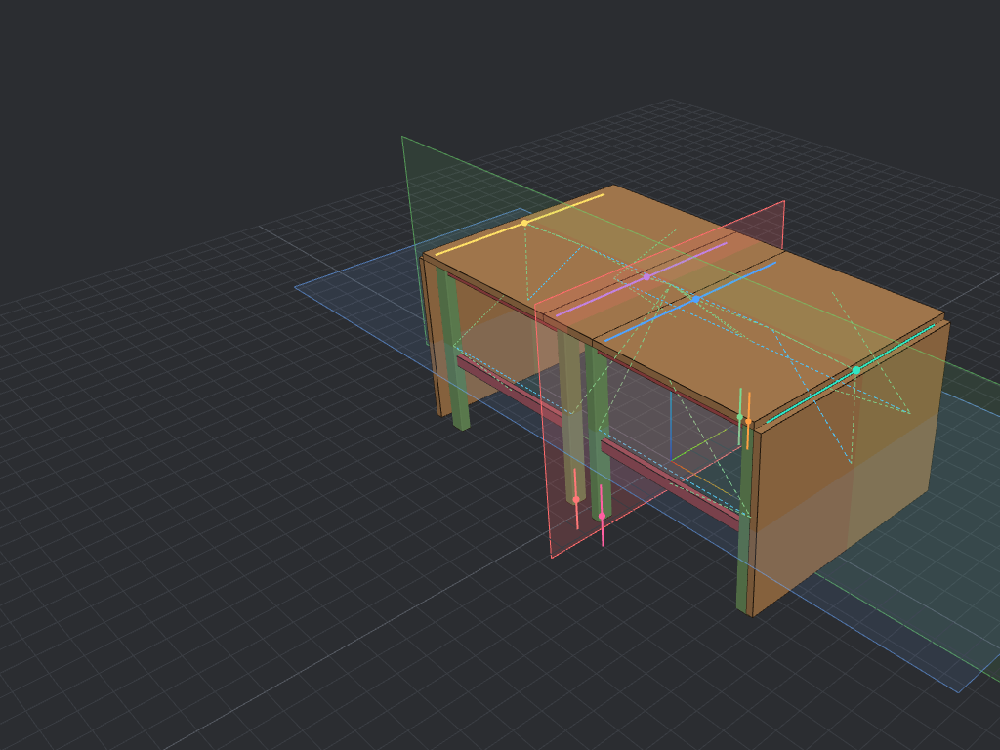

# cadchat

A small workbench for **code-CAD**: you describe parts and mechanisms in Python
([build123d](https://github.com/gumyr/build123d)), cadchat shows them in a local 3D viewer where you can click, measure,
cut cross sections, move joints, check collisions and prepare parts for the workshop or the 3D printer. A popup chat in
the viewer sends what you clicked, together with a screenshot, to an AI assistant (built for
[Claude Code](https://claude.com/claude-code)) that edits the model and answers in the same popup.



## What you get

- **Viewer** (browser, three.js): orbit, click and multi-select parts, isolate, dimensions, point-to-point measuring with
  corner snapping, a model switcher for everything in `parts/`.
- **Mechanisms**: joint sliders, presets (open / closed / ...), live collision check that names the clashing parts,
  colour-coded constraints (movable joints, fixed connections, parametric relations).
- **Parameters**: every dimension is a named parameter you can edit in the viewer; the model rebuilds.
- **Section planes**: saved, static planes with cut faces, several at once.
- **Make tab**: every distinct part laid flat on a 100 mm grid with dimensions, a cut list (CSV), a part inspector with
  Top/Front/Right views, a 3D view and a movable cross section.
  *Woodworking*: material totals. *3D printing*: bed size check and print plates exported as STL.
- **Chat bridge**: click a part, type "make this 60 mm", get the change and an answer. Works with any assistant that can
  watch `.cad/inbox.jsonl`; the repository ships skills for Claude Code in `.claude/skills/`.

## Quick start

```bash
python3 -m venv .venv
.venv/bin/pip install -r requirements.txt -r requirements-dev.txt
./cadchat run folding_table      # build the example mechanism
./cadchat serve                  # http://127.0.0.1:8765
```

Create your own:

```bash
./cadchat new part bracket2          # a static part
./cadchat new mechanism lidbox       # parts + joints + presets + collision check
./cadchat run bracket2               # build and publish; the viewer switches to it
./cadchat list
```

A model script is plain Python: parameters at the top, geometry with build123d, then `publish_kinematic(...)`.
See `templates/` and `parts/` (a shaft with a keyway, an L-bracket, a folding drop-leaf table).

## Tests

```bash
.venv/bin/python -m pytest -q          # kinematics, publisher, server API, templates, example models
node --test tests/js/*.test.js         # layout, slicing, STL, section planes, model switching
```

The project is developed test first, see [CONTRIBUTING.md](CONTRIBUTING.md). A ready-made GitHub Actions workflow is in `docs/ci-workflow.yml` (copy it to `.github/workflows/ci.yml`). Design notes, the data format, the HTTP API,
the security model and an evaluation of a Rust rewrite are in [docs/ARCHITECTURE.md](docs/ARCHITECTURE.md).

## Layout

```
parts/        model scripts (one per model)          templates/   starting points for new models
tools/        server, publisher, kinematics, CLI     tools/static viewer (index.html, app.js, lib/*.js pure logic)
tests/        pytest + node:test                     docs/        architecture notes
.claude/skills/  workflows for Claude Code           .cad/        generated models, chat log (git-ignored)
```

## Status

Early but working. Revolute joints only, one model shown at a time, three.js is loaded from a CDN (pinned version).
The viewer binds to 127.0.0.1 and checks the Host header and a per-run token before accepting changes.

## License

MIT, see [LICENSE](LICENSE).
